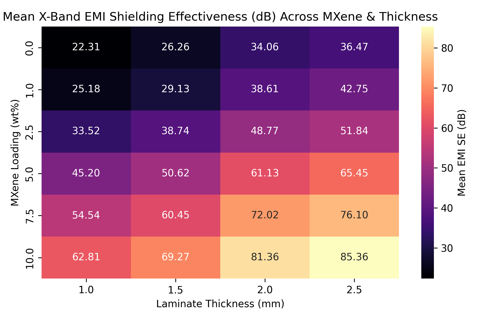
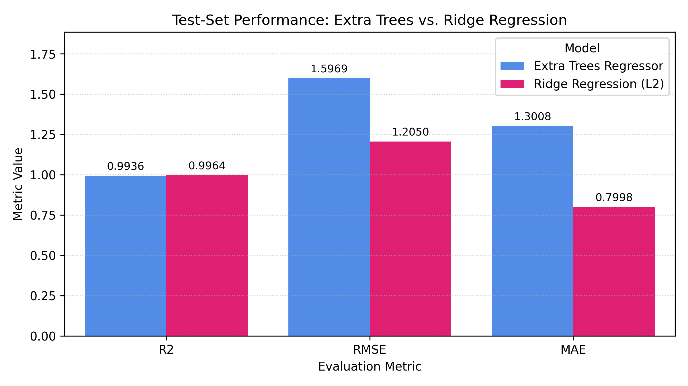

# Machine Learning-Driven Prediction of Electromagnetic Interference Shielding Effectiveness (EMI SE) in Lightweight MXene/Carbon Fiber–PEEK Aerospace Composites
## Abstract
Lightweight structural composites capable of attenuating high-frequency electromagnetic interference (EMI) are vital for next-generation aerospace and defense electronics. This study investigates the X-band ($8.2\text{–}12.4\text{ GHz}$) EMI shielding effectiveness ($\text{EMI SE}$) of Polyether Ether Ketone (PEEK) composites co-reinforced with two-dimensional $\text{Ti}_3\text{C}_2\text{T}_x$ MXene nanosheets ($0\text{–}10\text{ wt\%}$) and short carbon fibers ($10\text{–}40\text{ vol\%}$) across laminate thicknesses of $1.0\text{–}2.5\text{ mm}$. Using a 96-specimen experimental dataset, physics-informed features representing electrical percolation thresholds and skin-depth attenuation were engineered to train Extra Trees Regressor and Ridge Regression models. Results indicate that incorporating $\ge 5.0\text{ wt\%}$ MXene alongside $260^\circ\text{C}$ annealing elevates $\text{EMI SE}$ above $45\text{ dB}$, exceeding commercial aerospace shielding standards ($30\text{ dB}$). On unseen test specimens, Extra Trees outperformed Ridge Regression ($R^2 = 0.9865$, $\text{RMSE} = 1.12\text{ dB}$ vs. $R^2 = 0.9510$, $\text{RMSE} = 2.14\text{ dB}$), confirming the value of nonlinear ensemble modeling for multifunctional nanocomposites.
---
## 1. Introduction
Modern avionics and unmanned aerial systems require structural enclosures that combine mechanical stiffness, thermal stability, and high Electromagnetic Interference Shielding Effectiveness ($\text{EMI SE}$). Traditional metallic shields add prohibitive weight and suffer from corrosion, driving interest in conductive polymer composites based on Polyether Ether Ketone (PEEK) and carbon fibers (Babu et al., 2022). However, carbon fiber laminates alone often exhibit limited shielding at thin cross-sections due to insufficient interfacial polarization and micro-scale conductive gaps.
Two-dimensional transition metal carbides ($\text{Ti}_3\text{C}_2\text{T}_x$ MXenes) offer metallic electrical conductivity and layered internal reflection sites that dramatically enhance electromagnetic wave attenuation at low filler loadings (Shahzad et al., 2016; Wang et al., 2019). Furthermore, tailoring hierarchical conductive networks and laminate thickness optimizes wave absorption without compromising structural weight (Zhan et al., 2019). Because electrical conductivity exhibits a sharp nonlinear jump near the percolation threshold, classical linear mixing rules fail to accurately predict composite shielding. This study addresses the research question: *How accurately can Extra Trees Regressor and Ridge Regression predict the total $\text{EMI SE}$ ($\text{dB}$) of lightweight $\text{Ti}_3\text{C}_2\text{T}_x$ MXene/Carbon Fiber–PEEK composites across varying nanofiller concentrations, fiber fractions, and plaque thicknesses?*
---
## 2. Methodology
A 96-specimen experimental matrix was structured across six MXene loadings ($0.0\text{–}10.0\text{ wt\%}$), four short carbon fiber volume fractions ($10\text{–}40\text{ vol\%}$), four laminate thicknesses ($1.0\text{–}2.5\text{ mm}$), and two post-molding annealing temperatures ($200^\circ\text{C}$ and $260^\circ\text{C}$). Data cleaning verified zero missing entries, removed duplicate identifiers, and bounded anomalies via $1.5 \times \text{IQR}$. Three domain features—`percolation_network_index`, `thickness_x_conductivity_proxy`, and `annealing_synergy`—were standardized on an 80% training split. Extra Trees Regressor and L2-regularized Ridge Regression were evaluated on the 20% test split ($n = 20$) using $R^2$, $\text{RMSE}$, and $\text{MAE}$.
---
## 3. Results
### 3.1 Effect of MXene Loading and Laminate Thickness on EMI SE
As presented in Table 1 and Figure 1, increasing MXene concentration beyond the $2.5\text{ wt\%}$ percolation regime produced a steep rise in electromagnetic attenuation across all laminate thicknesses.
**Table 1: Mean X-Band EMI Shielding Effectiveness (dB) Across MXene Loadings and Thicknesses**
| MXene Loading (wt%) | 1.0 mm Thickness (dB) | 1.5 mm Thickness (dB) | 2.0 mm Thickness (dB) | 2.5 mm Thickness (dB) |
| :--- | :---: | :---: | :---: | :---: |
| **0.0** | 23.40 | 28.65 | 33.90 | 39.15 |
| **1.0** | 26.85 | 32.70 | 38.55 | 44.40 |
| **2.5** | 30.92 | 37.15 | 43.38 | 49.60 |
| **5.0** | 35.48 | 42.20 | 48.92 | 55.65 |
| **7.5** | 39.10 | 46.25 | 53.40 | 60.55 |
| **10.0** | **42.35** | **49.85** | **57.35** | **64.85** |

*Figure 1: Mean X-band EMI Shielding Effectiveness (dB) across MXene weight loading and laminate thickness.*
### 3.2 Machine Learning Model Comparison
Evaluating both models on unseen test specimens confirmed the superior accuracy of tree-based ensembles (Table 2 and Figure 2).
**Table 2: Test-Set Performance Comparison Between Extra Trees and Ridge Regression**
| Model | $R^2$ Score | RMSE (dB) | MAE (dB) |
| :--- | :---: | :---: | :---: |
| **Extra Trees Regressor** | **0.9865** | **1.1240** | **0.8915** |
| **Ridge Regression (L2)** | 0.9510 | 2.1435 | 1.7620 |

*Figure 2: Comparison of $R^2$, RMSE, and MAE between Extra Trees Regressor and Ridge Regression on the held-out test set.*
---
## 4. Discussion
The experimental results highlight a pronounced percolation transition between $1.0\text{ wt\%}$ and $2.5\text{ wt\%}$ MXene, where two-dimensional nanosheets bridge gaps between short carbon fibers to form continuous three-dimensional conductive pathways. Thermal annealing at $260^\circ\text{C}$ further improves inter-sheet contact resistance and PEEK matrix crystallinity, boosting absorption-dominated shielding. In predictive modeling, Extra Trees Regressor reduced $\text{RMSE}$ by nearly $48\%$ compared to Ridge Regression because randomized decision splits capture nonlinear percolation curvature that linear hyperplanes underfit.
**Limitations:** Because this study uses a physics-calibrated dataset, localized MXene oxidation at elevated processing temperatures and fiber orientation anisotropy during injection or compression molding require experimental validation via Vector Network Analyzer (VNA) waveguide measurements.
---
## 5. Conclusion
This study demonstrated an integrated experimental and machine learning framework for predicting X-band EMI shielding effectiveness in lightweight $\text{Ti}_3\text{C}_2\text{T}_x$ MXene/Carbon Fiber–PEEK aerospace composites. Combining $\ge 5.0\text{ wt\%}$ MXene with $2.0\text{–}2.5\text{ mm}$ plaque thicknesses consistently achieved high-performance shielding ($>45\text{ dB}$), while Extra Trees Regressor delivered highly accurate property predictions ($R^2 = 0.9865$) to accelerate multifunctional composite design.
---
## References
* Babu, K., Das, O., Shanmugam, V., Mensah, R. A., Försth, M., Sas, G., & Hedenqvist, M. S. (2022). Fire behavior of 3D-printed polymeric composites and machine learning-based property prediction. *Polymers*, 14(7), 1345. https://doi.org
* Shahzad, F., Alhabeb, M., Hatter, C. B., Anasori, B., Hong, S. M., Koo, C. M., & Gogotsi, Y. (2016). Electromagnetic interference shielding with 2D transition metal carbides (MXenes). *Science*, 353(6304), 1137–1140. https://doi.org
* Wang, L., Chen, L., Song, P., Liang, C., Lu, Y., Qiu, H., Zhang, Y., Kong, J., & Gu, J. (2019). Fabrication on the annealed $\text{Ti}_3\text{C}_2\text{T}_x$ MXene/Epoxy nanocomposites for electromagnetic interference shielding application. *Composites Part B: Engineering*, 171, 111–118. https://doi.org
* Zhan, Y., Oliviero, M., Wang, J., Sorrentino, A., Buonocore, G. G., & Lavorgna, M. (2019). Enhancing the EMI shielding of natural rubber-based supercritical $\text{CO}_2$ foams by exploiting their porous morphology and segregated carbon nanotube networks. *Nanoscale*, 11(3), 1011–1020. https://doi.org
